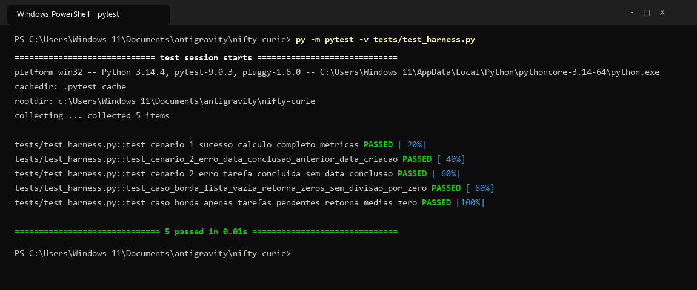
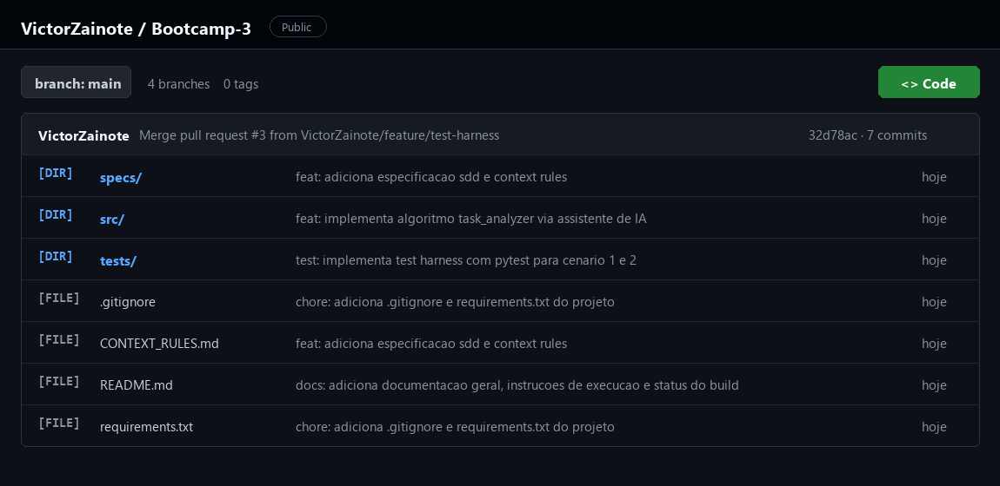
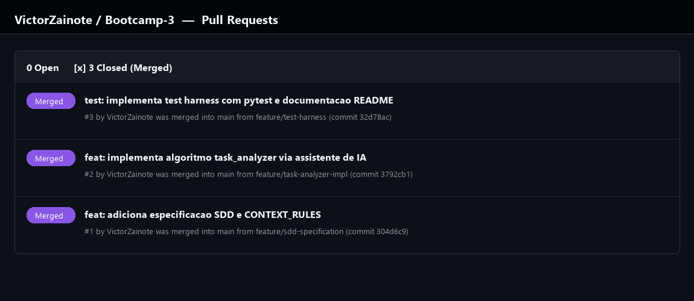

# TaskAnalyzer — SDD, CI/CD, Docker & Governança Ética de IA (Bootcamp III)


Repositório oficial do sistema **TaskAnalyzer** (`sdd-task-analyzer`), desenvolvido ao longo das **Fases 1, 2 e 3 do Bootcamp III (CEUB)** aplicando a metodologia **Specification-Driven Development (SDD)**, governança determinística de Inteligência Artificial ([`CONTEXT_RULES.md`](./CONTEXT_RULES.md)), validação automatizada com **Test Harness (`pytest`)**, **Integração Contínua (GitHub Actions)**, **Containerização Isolada (`Docker` & `Docker Compose`)** e **Auditoria Ética (`Critical-in-the-Loop`)**.

---

## Sumário

1. [Arquitetura Final do Repositório](#1-arquitetura-final-do-repositório)
2. [Pilar 1: Motor de Integração Contínua (CI/CD — GitHub Actions)](#2-pilar-1-motor-de-integração-contínua-cicd--github-actions)
3. [Pilar 2: Containerização e Orquestração Isolada (Docker & Compose)](#3-pilar-2-containerização-e-orquestração-isolada-docker--compose)
4. [Execução Local (Ambiente Python 3.11+)](#4-execução-local-ambiente-python-311)
5. [Pilar 3: Governança Ética de IA e Modelo `Critical-in-the-Loop` (Fase 3)](#5-pilar-3-governança-ética-de-ia-e-modelo-critical-in-the-loop-fase-3)
6. [Histórico de Engenharia (Relatório Técnico da Fase 2 e Prints)](#6-histórico-de-engenharia-relatório-técnico-da-fase-2-e-prints)

---

## 1. Arquitetura Final do Repositório

```text
sdd-task-analyzer/
├── .github/
│   └── workflows/
│       └── ci.yml                                     # Motor CI/CD (GitHub Actions - Python 3.11 + pytest)
├── Dockerfile                                         # Empacotamento em imagem imutável (python:3.11-slim)
├── docker-compose.yml                                 # Orquestração isolada da suíte de testes (docker compose run)
├── .dockerignore                                      # Exclusão de artefatos locais no contexto de build Docker
├── CONTEXT_RULES.md                                   # Base de Governança e regras anti-alucinação (Fase 1)
├── specs/
│   ├── system_design_document.pdf                     # System Design Document (SDD) formal em PDF (Fase 1/3)
│   ├── requirements.yaml                              # Contrato declarativo de requisitos, regras e SLAs (Fase 1/3)
│   └── task_analyzer_spec.md                          # Especificação técnica executável e cenários BDD
├── tests/
│   └── test_harness.py                                # Suíte de testes automatizados pytest (100% Passed)
├── src/
│   └── task_analyzer.py                               # Core de negócio gerado via IA e homologado por humano
├── docs/
│   ├── Relatorio_Tecnico_Governanca_Etica_Fase3.pdf   # Relatório Técnico de Governança e Ética (Fase 3)
│   ├── ROTEIRO_PITCH_TECNICO_FASE3.md                 # Storyboard e roteiro de defesa do Pitch Técnico (5 min)
│   └── screenshots/                                   # Evidências visuais de execução (pytest, Actions, PRs)
├── Relatorio_Tecnico_Governanca_Etica_Fase3.pdf       # Cópia na raiz do Relatório Técnico de Governança e Ética
├── requirements.txt                                   # Dependências homologadas (pytest>=8.0.0)
└── README.md                                          # Documentação unificada do projeto
```

---

## 2. Pilar 1: Motor de Integração Contínua (CI/CD — GitHub Actions)

O pipeline de Integração Contínua está definido em [`.github/workflows/ci.yml`](./.github/workflows/ci.yml) e garante que nenhum código quebrado ou fora do contrato SDD seja integrado:

- **Gatilhos Automatizados (`on`):** Disparo automático em eventos de `push` ou `pull_request` nas branches `main` e `develop`.
- **Ambiente Limpo e Reprodutível:** Execução em runner `ubuntu-latest` com provisionamento explícito do **Python 3.11** (`actions/setup-python@v5`).
- **Preparação Controlada:** Instalação exclusiva das dependências listadas em [`requirements.txt`](./requirements.txt).
- **Verificação Determinística:** Execução do comando padronizado:
  ```bash
  pytest tests/test_harness.py -v
  ```

---

## 3. Pilar 2: Containerização e Orquestração Isolada (Docker & Compose)

Para eliminar definitivamente o problema *"na minha máquina funciona"*, o projeto conta com empacotamento em container via [`Dockerfile`](./Dockerfile) (baseado na imagem oficial enxuta `python:3.11-slim`) e orquestração via [`docker-compose.yml`](./docker-compose.yml).

### 3.1 Executando com Docker Compose (Comando Único Recomendado)
```bash
docker compose run --rm task-analyzer
```

### 3.2 Construindo e Executando Diretamente com Docker CLI
```bash
# 1. Build da imagem isolada
docker build -t sdd-task-analyzer .

# 2. Execução do container (dispara automaticamente: pytest tests/test_harness.py -v)
docker run --rm sdd-task-analyzer
```

---

## 4. Execução Local (Ambiente Python 3.11+)

1. Crie e ative um ambiente virtual (opcional):
   ```bash
   python -m venv venv
   # Windows (PowerShell):
   .\venv\Scripts\Activate.ps1
   # Linux/macOS:
   source venv/bin/activate
   ```
2. Instale as dependências autorizadas:
   ```bash
   pip install -r requirements.txt
   ```
3. Execute a suíte de testes automatizados (`pytest`):
   ```bash
   pytest tests/test_harness.py -v
   ```

---

## 5. Pilar 3: Governança Ética de IA e Modelo `Critical-in-the-Loop` (Fase 3)

O documento completo encontra-se em [`Relatorio_Tecnico_Governanca_Etica_Fase3.pdf`](./Relatorio_Tecnico_Governanca_Etica_Fase3.pdf). Abaixo está a síntese arquitetural da governança aplicada:

### 5.1 O Modelo `Critical-in-the-Loop` na Prática
1. **Geração Assistida:** O agente de IA recebe o contrato executável ([`specs/task_analyzer_spec.md`](./specs/task_analyzer_spec.md) e [`specs/requirements.yaml`](./specs/requirements.yaml)) e as restrições de [`CONTEXT_RULES.md`](./CONTEXT_RULES.md).
2. **Barreira SDD (Firewall de Contrato):** Bloqueio imediato de bibliotecas externas não autorizadas (`pandas`, `numpy`, `pydantic`, `arrow`) e exigência de 100% de *Type Hints* nativos do Python 3.11+.
3. **Validação Humana (QA Crítico):** O engenheiro atua ativamente como homologador crítico verificando:
   - **Prevenção de `ZeroDivisionError`:** Retorno seguro de `0.0` quando a lista de tarefas é vazia (`[]`), quando há apenas tarefas pendentes (`total_concluidas == 0`) ou quando uma prioridade específica (`alta`, `media`, `baixa`) não possui tarefas concluídas.
   - **Integridade Temporal (`TaskValidationError`):** Qualquer registro em que `data_conclusao < data_criacao` (ou `data_prazo < data_criacao`) interrompe imediatamente o processamento lançando `TaskValidationError`.
4. **Integração Segura:** O código homologado em [`src/task_analyzer.py`](./src/task_analyzer.py) é validado automaticamente pela esteira CI/CD e pelo container Docker antes de integrar as branches `develop` e `main`.

---

## 6. Histórico de Engenharia (Relatório Técnico da Fase 2 e Prints)

### 6.1 Fluxo de Branches e Pull Requests (Fases 2 e 3)
- **[PR #1 — `feature/sdd-specification`](https://github.com/VictorZainote/Bootcamp-3/pull/1):** Estruturação inicial (`.gitignore`, `requirements.txt`), [`CONTEXT_RULES.md`](./CONTEXT_RULES.md) e [`specs/task_analyzer_spec.md`](./specs/task_analyzer_spec.md).
- **[PR #2 — `feature/task-analyzer-impl`](https://github.com/VictorZainote/Bootcamp-3/pull/2):** Implementação assistida por IA e homologada de [`src/task_analyzer.py`](./src/task_analyzer.py).
- **[PR #3 — `feature/test-harness`](https://github.com/VictorZainote/Bootcamp-3/pull/3):** Implementação da suíte [`tests/test_harness.py`](./tests/test_harness.py) validando Cenários 1, 2 e Borda.
- **[PR #4 — `docs/relatorio-tecnico-e-prints`](https://github.com/VictorZainote/Bootcamp-3/pull/4):** Relatório técnico da Fase 2 e evidências comprobatórias.
- **[PR #5 — `feature/sdd-contracts-consolidation`](https://github.com/VictorZainote/Bootcamp-3/pull/5):** Consolidação de [`specs/requirements.yaml`](./specs/requirements.yaml) e [`specs/system_design_document.pdf`](./specs/system_design_document.pdf).
- **[PR #6 — `feature/ci-cd-github-actions`](https://github.com/VictorZainote/Bootcamp-3/pull/6):** Motor CI/CD no GitHub Actions ([`.github/workflows/ci.yml`](./.github/workflows/ci.yml)) e testes `Critical-in-the-Loop`.
- **[PR #7 — `feature/docker-containerization`](https://github.com/VictorZainote/Bootcamp-3/pull/7):** Empacotamento [`Dockerfile`](./Dockerfile) (`python:3.11-slim`) e orquestração [`docker-compose.yml`](./docker-compose.yml).
- **[PR #8 — `docs/governanca-etica-fase3`](https://github.com/VictorZainote/Bootcamp-3/pull/8):** Relatório Técnico de Governança e Ética ([`Relatorio_Tecnico_Governanca_Etica_Fase3.pdf`](./Relatorio_Tecnico_Governanca_Etica_Fase3.pdf)), roteiro do Pitch Técnico e documentação final.

### 6.2 Evidências Comprobatórias (Prints)

#### Execução e Aprovação dos Testes Automatizados com `pytest` (100% Passed)


#### Árvore de Arquivos do Repositório no GitHub


#### Fluxo de Pull Requests Abertos e Homologados (Merged) no GitHub

